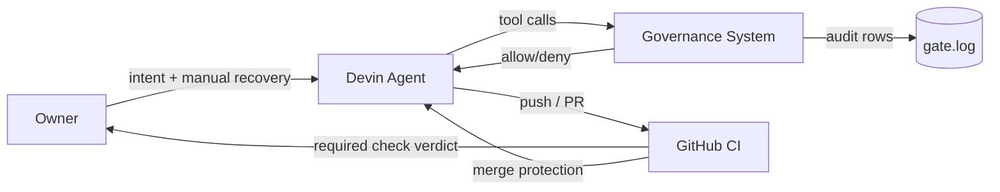

# 02 — Context and Scope (arc42 §3)

## Business context

The Owner directs Devin (an AI coding agent) to work on local projects. Devin
executes shell commands, edits files, searches code, and calls MCP tools.
Without governance every one of those actions is unaudited and unbounded.
The governance system sits between Devin's intent and its tool execution:
it decides allow/deny locally, records evidence, and defers final verdicts
(merge/no-merge) to GitHub — outside the agent's reach (ADR-004).

## Technical context

| Element | Role | Notes |
|---|---|---|
| Devin CLI (Windows) | Agent runtime | Reads hooks from %APPDATA%/devin/config.json; hooks load at SessionStart only (ERR-004) |
| WSL2 (Ubuntu-24.04) | Gate runtime | gate.sh + OPA run here; chosen over Git Bash (ADR-001, ERR-007) |
| OPA / Rego | Policy engine | main.rego aggregates denies from P1–P5 into one decision |
| gate.log | Audit sink | Append-only log inside the governed repo |
| gh CLI | CI administration | WSL-only (v2.45.0), authed as ErrWin666 |
| GitHub Actions + Rulesets | Final enforcement | ci-test testbed: ruleset #26814146, required check, CODEOWNERS |

## System context diagram (C4 Level 1)

## External interfaces (data crossing the boundary)

| Interface | Direction | Content |
|---|---|---|
| PreToolUse stdin | Devin → Gate | JSON payload: tool_name, tool input, cwd (logged as PWD-PROOF) |
| Hook exit code | Gate → Devin | 0 = allow, 2 = block, other = logged-not-blocking unless fail_closed:true (then block) |
| gate.log append | Gate → log | PWD-PROOF, DENY reasons, GOV_GATE_DOWN, FORK-RETRY markers |
| PostToolUse payload | Devin → audit | tool_response + tool_use_id per executed call |
| git push / PR | Devin → GitHub | Triggers required status check on protected branch |
| Ruleset verdict | GitHub → merge | Required check "Verify test files are frozen"; CODEOWNERS review |

## Scope boundary

**In scope:** every tool call Devin makes through its harness; governance
files; test-evidence freeze; CI merge gate.
**Out of scope (honest gaps, STATE.md §2):** `devin -p --config` subprocess
(ERR-009), destructive local exec via fail-open seam, permissions.deny
(ERR-008), owner lockout on WSL crash.
