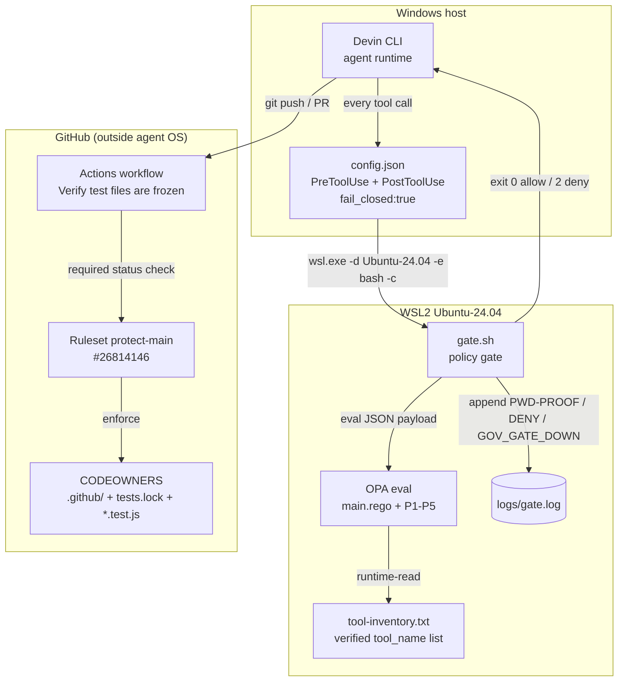

# 03 — Building Block View (arc42 §5)

## Overview

Four containers: the agent runtime (Devin CLI on Windows), the policy gate
(WSL2), the audit sink (gate.log), and the external enforcement plane
(GitHub). Local containers are detection-tier; GitHub is the only true
enforcement wall (ADR-004).

## Container diagram (C4 Level 2)

## Containers

### Devin CLI (Windows)
Agent runtime emitting tool calls. Hooks configured in
%APPDATA%/devin/config.json (PreToolUse fail_closed:true — ADR-002;
PostToolUse audit). Hooks load at SessionStart only (ERR-004). Key files:
config.json, mcp_config.json — both P4-protected (ADR-003).

### WSL2 Ubuntu-24.04 — policy gate
Runs gate.sh, which logs PWD-PROOF, invokes OPA, appends verdicts, and
returns exit 0/2. Runs on WSL not Git Bash — MSYS2 fork failures made hook
behavior undefined (ADR-001, ERR-007). Key files: policies/gate.sh,
main.rego (PDP entrypoint aggregating all denies into one decision).

### OPA policies P1–P5
One deny set, aggregated by main.rego:
- **P1** p1_deny_wsl_root — `wsl -u root` sidesteps every file/exec boundary
- **P2** p2_deny_test_edit — locked tests are frozen iff tests.lock exists
- **P3** p3_deny_secrets — secrets in files/commands/URLs/MCP payloads
- **P4** p4_require_evidence — phase transitions need
  evidence/P<n>/manifest.json; also makes governance files read-only
  through agent tools (ADR-003)
- **P5** p5_deny_unrecognized_tool — catch-all: tool_name outside the
  verified inventory is denied by default (ERR-006)

### GitHub enforcement plane
Actions workflow provides the required status check "Verify test files are
frozen"; Ruleset protect-main (#26814146) makes it blocking; CODEOWNERS
covers tests.lock, *.test.js, and .github/ itself. Proven: PR #1 on ci-test
blocked (ADR-004). Administered via gh CLI in WSL only (v2.45.0).

## Notable absences (by decision)

- **permissions.deny** — dead code, not a building block (ADR-005, ERR-008)
- **MCP proxy** — rejected as sole enforcement; doesn't cover native tools
- **Git Bash runtime** — retired (ERR-007); backups kept:
  gate.sh.gitbash.bak, gate.sh.timeout.bak
