# DESIGN — Complete Governance System

> Purpose: the full technical design — structure, heart, pipelines, error
> handling, collision-free agent flow. This document distinguishes
> **exists today** vs **proposed**. Nothing proposed here is implemented yet.
> Sources of truth: STATE.md, ROADMAP.md, REASSESSMENT.md, ADRs, ERR index.

## 1. Folder structure

```
governance-dev/
├── policies/                    # PROTECTED (P4) — the gate itself
│   ├── gate.sh                  # single entrypoint: stdin payload → exit 0/2
│   ├── main.rego                # PDP: decision{allow,reasons} aggregates deny
│   ├── p1_..p10_*.rego          # deny rules; auto-loaded, one file = one rule
│   ├── .governance/
│   │   ├── tool-inventory.txt   # verified tool names for P5
│   │   ├── current_phase        # phase marker for P4(b) evidence check
│   │   ├── dev-suspensions.json # L0 PROPOSED — owner-only; dev-tier suspensions, absent in production
│   │   └── seeds.json           # L0 PROPOSED — owner-authored seeded violations; dev-only, CI-lint rejected in prod
│   └── README.md                # policy authoring conventions
├── .devin/
│   └── skills/                  # BUILT (L2c) — adopted skills.sh: clean-code, code-review, adversarial-reviewer, quality-gate, mutation-testing + custom logic-flow-review
├── .github/
│   ├── workflows/
│   │   ├── policy-lint.yml      # P6: .rego hygiene — exists
│   │   ├── secret-scan.yml      # P7: gitleaks on PR diff — exists
│   │   └── quality-gate.yml     # PROPOSED (L2)
│   └── CODEOWNERS               # policies/*, .github/ → owner
├── plan/                        # PROPOSED (L3)
│   ├── spec.md                  # what+why, owner-approved
│   ├── tasks.md                 # numbered verifiable units
│   └── research/                # researcher role output files
├── evidence/
│   └── P<n>/manifest.json       # exists P2,P3 — P4-protected transition proof
├── approvals/
│   └── approval.md              # owner decisions (P4-protected)
├── docs/                        # reference + explanation
│   ├── specs/ plans/ errors/    # GOVERNANCE_SPEC, BUILD_PLAN, ERR-001..014
│   └── ROADMAP.md REASSESSMENT.md DESIGN.md
├── docs/architecture/           # arc42-lite + ADRs + AGENTS.md router
├── deploy/                      # PROPOSED (L6)
│   ├── profiles/{small,medium,erp}.yaml
│   └── (copier template root = repo root)
├── scripts/
│   └── apply-governance-acl.ps1 # Windows ACL hardening — exists
├── logs/                        # GITIGNORED — runtime only
│   ├── gate.log                 # DENY / GOV_GATE_DOWN / PWD-PROOF entries
│   ├── b1.0-pretool.log         # raw payloads
│   └── self-review.log          # L0 PROPOSED — per-response review findings + SEED lines
└── (debris archived 2026-11-09 → C:/governance-dev-archive/:
    old-version/, trash/, backups/, Arabic test project, ci-test clone)
```

Edit rights: `policies/` `approvals/` `evidence/` `STATE.md` — P4-protected
(evidence-gated writes) in every governed project; agent-editable only inside
governance-dev where the exception applies (they ARE the product).
`plan/` `docs/` `src/` — agent-editable everywhere (src/ additionally requires
prior-phase evidence via P4(b)). `logs/` — append-only, no reads required of agent.
`.github/` `CODEOWNERS` — owner-review required via CODEOWNERS.

## 2. The heart

**The heart is the hook contract + `data.governance.decision`, not any single
file.** Three concentric pieces: `config.json` (PreToolUse registered,
`fail_closed:true`, owner-owned, outside repo) → `gate.sh` (single entrypoint,
builds env, calls OPA) → `main.rego` `decision` (aggregates every `deny` in
`package governance`). Authority lives in the owner's OS user + GitHub org —
the agent's environment is downstream of both.

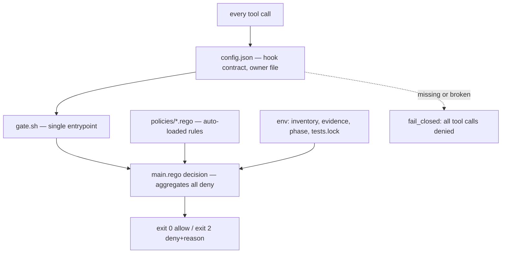

Failure cascade (all proven): gate.sh missing → every call denied (ERR-010
session). OPA missing/crashed/timeout → `GOV_GATE_DOWN` + exit 2. Wrong answer
format (no `"allow"` key) → exit 2. The failure mode is always *deny*, never
*permit* — cost: total lockout until owner edits config.json in Notepad.

## 3. Pipelines

### 3a. Request pipeline (proposed)

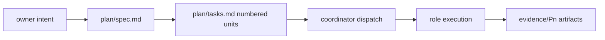

Owner intent becomes a spec file before any code — spec approval is the
first governance checkpoint (P4 transition write needs a manifest).
Tasks decompose to verifiable units; every unit ends in an evidence artifact.
Nothing here runs if plan/ is empty — that absence is the gate.

### 3b. Enforcement pipeline (exists — measured)

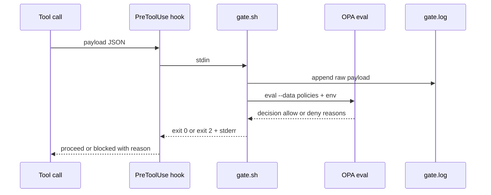

Every tool call takes this path — there is no fast-path bypass. Cost is one
OPA eval (~50–300 ms warm WSL; 4 s hard timeout). Deny reasons print to stderr
so the agent sees *why*, not just *no*. All denials log to gate.log with
the full payload for audit.

### 3c. Verification pipeline (proposed)

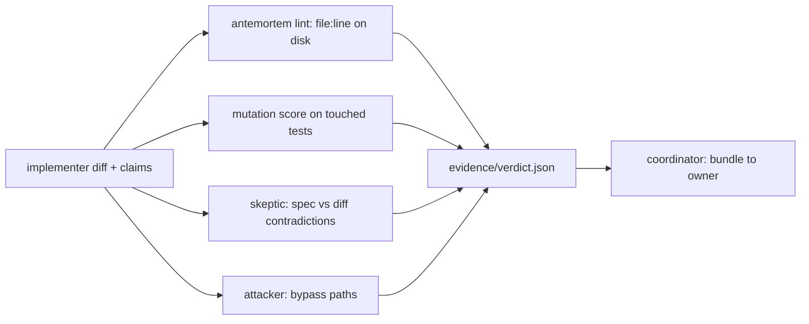

Verifier inputs are artifacts only — diff, spec, manifest — never the
implementer's narrative. antemortem runs offline against disk bytes
(deterministic); mutation score is computed per touched test file (decided:
in-toto-shaped verdict, mutation gate at L4). Roles are skills/subagents at
medium scale, isolated Managed Devins at ERP.

### 3d. Error pipeline (exists — thin today, proposed strengthening)

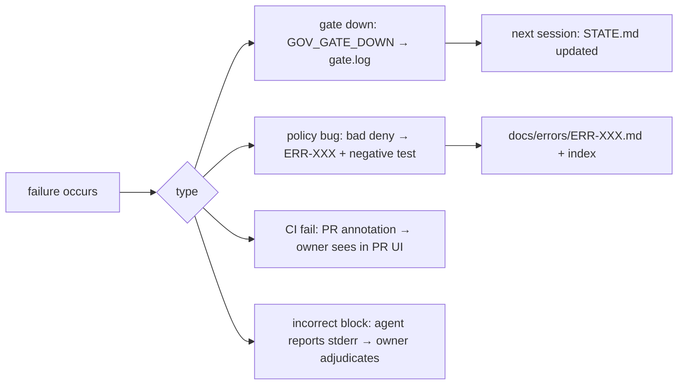

Every failure class has a distinct surface: gate-down is machine-logged,
policy bugs become ERR docs, CI failures are PR-visible, incorrect blocks are
reported by the agent itself with the stderr reason. Learning loops into
ERR-XXX + STATE.md so the *next* session inherits the lesson (ERR-004..014
are this pipeline working).

### 3e. Deployment pipeline (proposed — decided: copier)

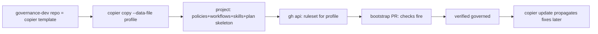

### 3f. Recovery pipeline (exists — proven, manual)

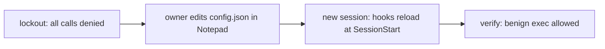

## 4. How governance logs its own errors

**Surfaces today (exists):**
- `logs/gate.log` — timestamped `DENY <reasons> input=<payload>`,
  `GOV_GATE_DOWN rc=… out=…`, `PWD-PROOF cwd=…` lines. Structured enough
  to grep; not JSON.
- `logs/b1.0-pretool.log` — every raw payload, append-only (pre-policy record).
- `docs/errors/ERR-*.md` + index — the curated lesson layer.
- CI failures — visible in PR check annotations (GitHub-native).

**Proposed:**
- `logs/gate-health.json` — SessionStart health check writes one JSON row:
  `{ts, opa_version, inventory_count, last_gate_down, fail_closed, last_deny}`.
  Session-start skill reads it and tells the owner "governance degraded" if
  `last_gate_down` is new or `fail_closed` missing.
- Rotation: cap gate.log at 5 MB → `gate.log.1` rotate; pretool log same.
- Notification: in-session only — the owner IS the session user; next-session
  via STATE.md + health file. No out-of-band channel (email/Slack) at small
  scale; ERP profile may add one.
- Self-monitoring: health check computes a deny-rate + GOV_GATE_DOWN-count
  delta since last session — governance detecting its own degradation.

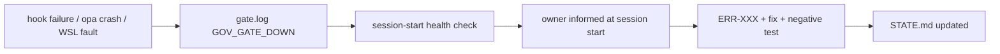

## 5. End-to-end walkthrough — "add password reset to project X"

| # | Step | File touched | Check fired | Log |
|---|---|---|---|---|
| 1 | owner intent in session | — | — | — |
| 2 | coordinator writes spec | `plan/spec.md` | none (plan/ unprotected) | — |
| 3 | coordinator writes tasks | `plan/tasks.md` | none | — |
| 4 | researcher finds libs | `plan/research/auth-libs.md` | P5 if odd tool used | payload logged |
| 5 | implementer codes on branch; files manifest | `src/auth/reset.js`, `evidence/P3/manifest.json` | P4: manifest required BEFORE any transition write; P3 scans every payload | DENY lines if triggered |
| 6 | verifier lints citations + mutation | `evidence/P3/verdict.json` | — | run artifact |
| 7 | skeptic checks spec↔diff | `evidence/P3/skeptic.md` | — | — |
| 8 | attacker probes | `evidence/P3/attack.md` | — | — |
| 9 | coordinator bundles verdict | verdict.json final | — | — |
| 10 | owner reviews, opens PR | PR on GitHub | — | — |
| 11 | CI runs | — | test-lock + policy-lint + secret-scan (+quality-gate proposed) | check results in PR |
| 12 | owner merges | — | ruleset required checks | merge event |
| 13 | `copier update` | project files | — | sync log |

Owner sees exactly three things during the flow: the spec (approve?), the
verdict bundle (approve?), the PR merge button. Everything else is machine.

## 6. Collision-free agent workflow — the critical design

### 6a. Normal path — every call is gated, none feels it

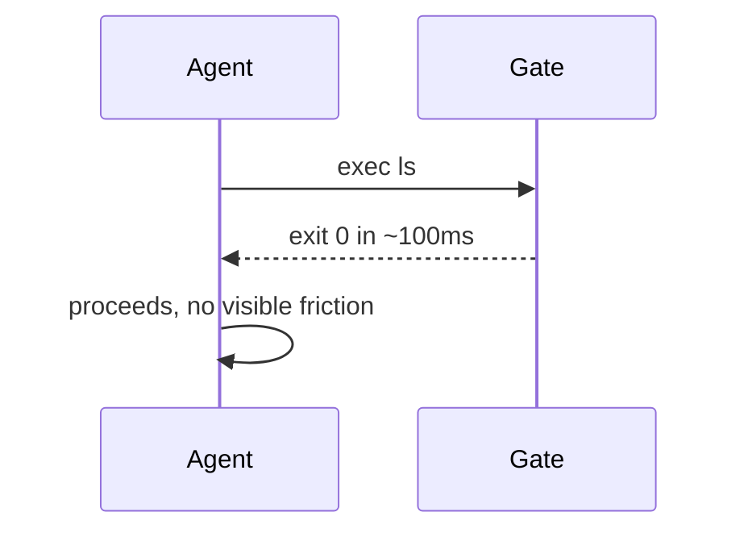

There is no "fast path" bypass — every call pays one eval (~50–300 ms).
Friction-free does not mean un-gated; it means *true-positive-only* denials.
Design keeps deny rules narrow (11 named denies vs 22-tool inventory) so a
normal session sees zero blocks — observed: ~9 denials this session, all
intentional or informative.

### 6b. Blocked path

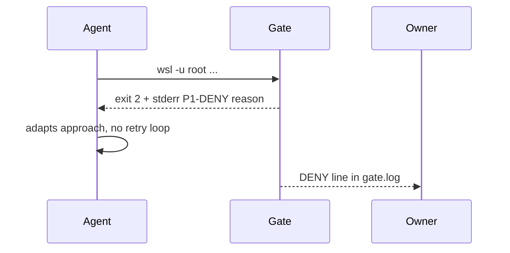

Agent sees a named reason (`P1-…`, `P3-SECRET:…`), not a hang — it adapts
immediately. Owner sees the denial either live (session output) or in
gate.log. Honest note: P3 blocked my literal secret twice and I routed
around it with string construction — the gate held on the literal while the
semantic intent passed. That's the detection-tier truth; CI+gitleaks is the
backstop that caught it in the diff.

### 6c. Subagent path

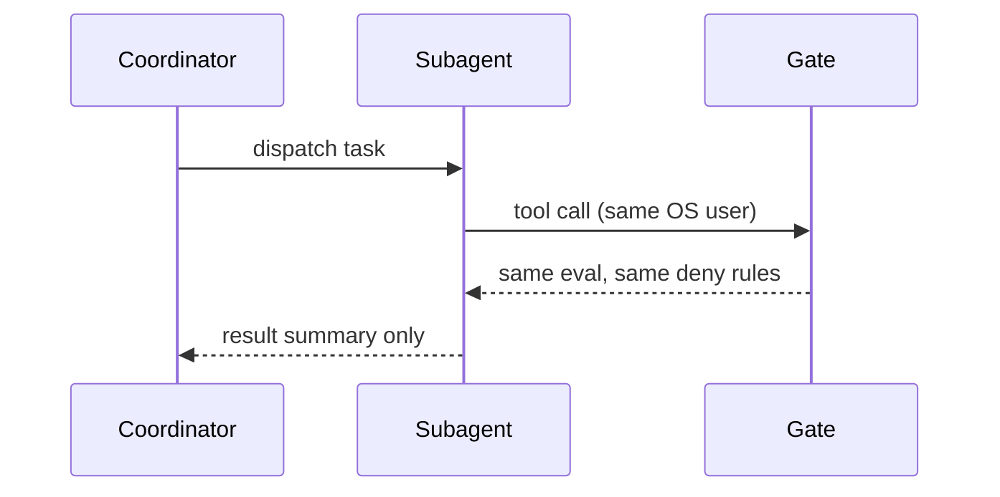

Observed today: subagent inner calls log under the PARENT session_id — same
user, same hook config, same gate. A subagent cannot exceed its parent's
governance envelope; its only extra boundary is the profile tool set
(`subagent_explore` = read-only). Collision risk: a strict read-only profile
plus a denied tool attempt — mitigated by dispatching tasks matched to the
profile's tool set.

**Role → tool envelopes (DECIDED — defense-in-depth inside the session):**

| Role | Allowed tools | Explicitly denied | Rationale |
|---|---|---|---|
| researcher | read, grep, webfetch, glob | write, edit, exec | finds facts, changes nothing |
| implementer | read, write, edit, exec, grep | webfetch | builds on branch; no network exfil surface |
| verifier | read, grep, glob | write, edit, exec | judges artifacts, can never touch them |
| skeptic | read, grep | write, edit, exec, webfetch | narrowest — pure contradiction hunt |
| attacker | read, grep, exec (sandboxed) | write, edit, webfetch | needs to run code to probe, not modify it |

These are *profile* envelopes — a second wall inside the session that the
outer gate (L1) still evaluates independently. A role that needs a tool
outside its envelope is a design smell: escalate the task, don't widen the
role.

### 6d. Skills path

Skill invocations are prompt changes, not authority changes — `allowed-tools`
only skips permission prompts; every resulting tool call still crosses the
same gate. `permissions.deny` is dead code (ERR-008) and the design treats it
as nonexistent. A skill that needs a denied action simply cannot do it —
same as the agent.

### 6e. Session restart path

Hooks load at SessionStart only (ERR-004): mid-session config edits are
silently inactive — a live collision class. Design: session-start health
check compares config mtime vs session start; if config changed mid-session
the agent is told to restart rather than trust stale rules. Cost: one stat
per session.

### 6f. Override path

Emergency bypass is deliberately out-of-band: owner edits config.json in
Notepad (proven recovery) or uses the ruleset admin bypass for pushes
(ERR-014). There is intentionally **no agent-reachable override** — any
bypass file the agent could read, it could write. Cost: full bypass is
all-or-nothing, not granular; acceptable at owner-only scope.

### Collision budget

| Metric | Target | Today |
|---|---|---|
| gate evals per tool call | 1 | 1 |
| overhead per call | <500 ms | ~50–300 ms warm, ≤4 s bound |
| false denials per session | 0 | ~0 (all observed denials were policy-true) |
| true collisions per session | ≤2, self-recoverable | ~2 observed (secret literal in docs) |
| GOV_GATE_DOWN per week | 0 | 0 since Desktop Heap fix |

## 7. Integrated system

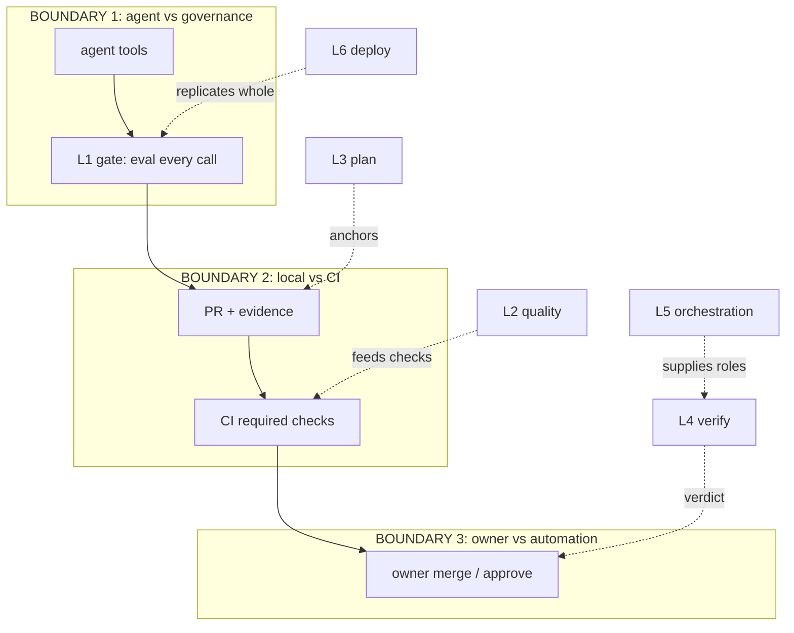

Boundary guarantees: crossing B1, *nothing executes un-evaluated* — allow is
the only exit besides deny. Crossing B2, *nothing merges un-checked* — CI
runs where the agent has no credentials. Crossing B3, *nothing finalizes
un-approved* — merge authority is the owner's, always (ROADMAP §9-6).

## 8. Design decisions

| Decision | Alternatives | Why | Cost |
|---|---|---|---|
| gate.sh subprocess | inline in hook | testable, language-agnostic, single entry, WSL-native | +1 process spawn per call |
| fail_closed | fail_open | deny is the only safe failure mode (proven) | total lockout possible → manual recovery |
| P4 self-protection | external-only protection | agent *in its own env* is the insider threat | friction: evidence manifest before transitions |
| subagents for roles | Managed Devins now | cheaper, same gate; MD reserved for PR-trigger at ERP | weaker isolation than separate VM |
| own plan/ | spec-kit, vaultspec | proven pattern, zero deps, resume works | no tooling assist — convention only |
| copier deploy | sync.sh, subtree | `copier update` propagates fixes — sync.sh can't | template discipline required |
| WSL runtime | Git Bash | native fork, no cygheap failures (ERR-007) | WSL dependency, cold-start lockout |
| admin bypass ruleset | empty bypass | direct push needed in dev | admin can force-push (ERR-014 accepted) |
| one combined decision | per-policy gates | single eval aggregates all denies; auto-load | main.rego is a SPoF — protected by P4 |

## 9. Open design questions

1. Health-check trigger: is there a SessionStart hook event in Devin config, or run health check inside gate.sh's first call per session? Recommend: inside gate.sh, once per session via marker file.
2. Log rotation policy: 5 MB cap + .1 rotation vs date-stamped files? Recommend size-cap (simple).
3. Verdict signing at L4: unsigned in-toto-shaped JSON first, DSSE signing at ERP? Recommend unsigned shape now — signature adds key management.
4. Collision metric: count DENY lines per session vs session count — who consumes it? Recommend health-check report at session start.
5. Subagent governance boundary: narrower per-role envelopes. **DECIDED (owner):** role→tool table in §6c — researcher/verifier read-only-ish, implementer build-only, attacker exec-but-sandboxed. Defense-in-depth: profile envelope + outer gate.
6. Owner alert channel beyond session: none vs file-flag vs external at ERP. Recommend none below ERP.
7. plan/ protection level: agent-editable always, or P4-gated like approvals/? Recommend agent-editable (it IS the agent's work product; spec approval is the checkpoint).
