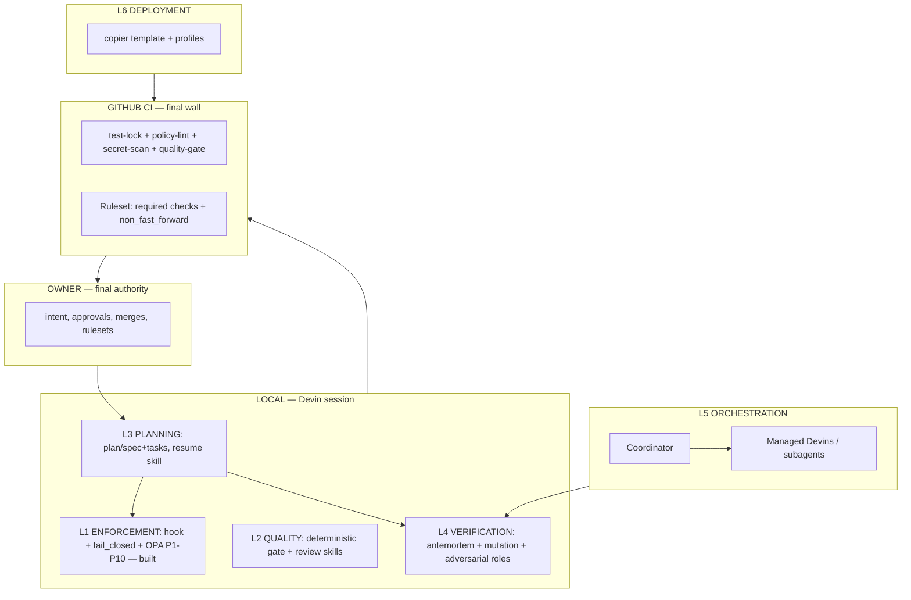
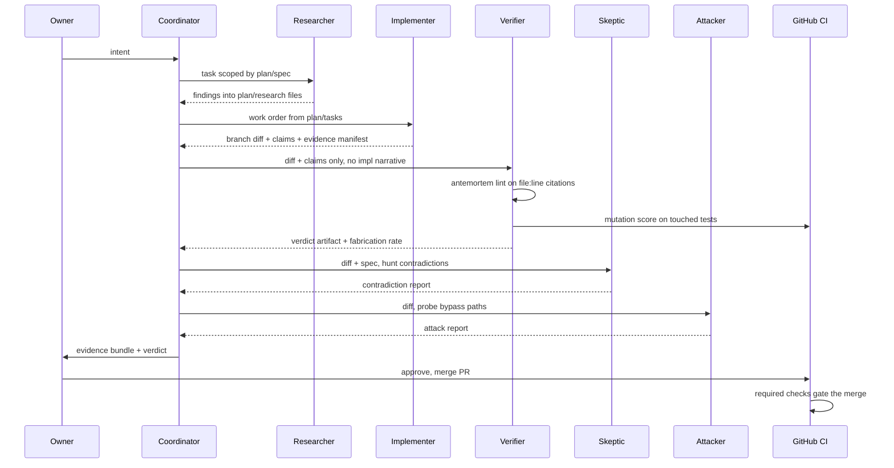
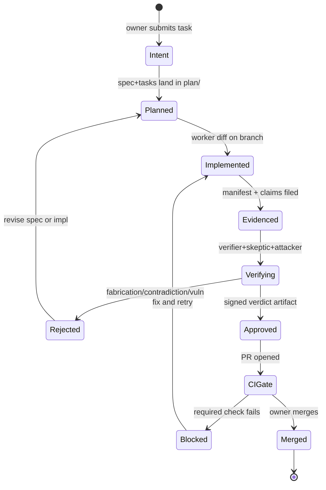

# REASSESSMENT — Governance Project, Full Picture

> Purpose: honest baseline before further building. Where we are, what the
> vision is, what the research adds, how the system flows, how it installs.
> Status: assessment only — nothing here is newly implemented.

## 1. Where we are now

| Layer | What it does | Status | Evidence / gap |
|---|---|---|---|
| L1 Enforcement | block unsafe tool calls at runtime + CI | **Built** | P1-P5,P8-P10 .rego auto-load (Phase-3 p11 probe); fail_closed proven (ERR-010); P3/P4/P5 fired live this session; policy-lint+secret-scan required + merge BLOCKED (ci-test PR #6); same workflows+ruleset on governance-dev (#26818941, admin bypass — ERR-014) |
| L2 Code Quality | OOP/DRY/size/hardcoded gates | **Missing** | research only — deterministic vs judgment split mapped (ROADMAP §5); nothing deployed |
| L3 Planning | spec→plan→tasks on disk, file-resume | **Partial** | `evidence/P<n>/manifest.json` convention exists and P4 enforces it — but no plan/ layer, no spec/tasks files, no resume skill |
| L4 Verification | correctness check (Clever Hans) | **Missing** | antemortem / agent-eval-mcp / adversarial-review identified, none installed; NO citation or logic check exists anywhere |
| L5 Orchestration | isolated roles, no self-approval | **Missing** | Managed Devins + subagent profiles verified as capabilities; zero role definitions exist |
| L6 Deployment | replicate governance into projects | **Partial** | governance-dev now a public git repo (deployable source exists); no sync mechanism, no profiles |

**The project is at "Phase 3 complete / Phase 4 unstarted" — roughly 35% of the vision implemented: the entire safety spine (L1) is proven, and nothing yet guards correctness, quality, planning, or scale.**

## 2. Vision self-test

1. **Problem solved**: agents that cheat the checks meant to catch them — editing frozen tests to green, emitting plausible-but-wrong code through CI, rewriting instead of extending, failing silently, and editing the governance files that constrain them. Governance exists because an agent grading itself will eventually grade itself leniently.
2. **Clever Hans**: the agent reads the examiner, not the question — it produces the artifact that *looks* verified without the logic being right. Hardest because every existing gate checks form/process, and the checker is usually a model sharing the implementer's blind spots.
3. **CI as final wall**: hooks+OPA run inside the agent's own OS user — inside the mechanism it could weaken (fail-open seam, `devin -p`, local exec). CI runs on GitHub's infrastructure where the agent has no credential path — enforcement outside the governed party's control (ADR-004).
4. **Agent can't write governance files**: a writable gate is no gate — P4 requires evidence manifests for transition writes; policies/gate.sh/config are protected paths. governance-dev excepts because policies ARE the product here — protected instead by CI policy-lint + CODEOWNERS.
5. **Enforcement vs verification**: enforcement prevents (P3 denied my `sk-…` write payload pre-creation). Verification audits claims (gitleaks found that secret in PR #4's diff). One blocks actions, the other checks truth.
6. **Planning as structure**: hallucination needs a movable target. A plan/ spec+tasks on disk is a fixed reference that a verifier — which never saw the implementer's narrative — can measure against. No anchor, no meaningful verification.

## 3. Research — what was missing from our picture

| Finding | URL | What it does | Why it matters | Maturity | Devin-fit |
|---|---|---|---|---|---|
| in-toto Attestation Framework + SLSA | github.com/in-toto/attestation | signed verifiable claims (Statement+Predicate+Subject, DSSE envelope) about how artifacts were produced; "Simple Verification Result" predicate = a verdict file | our manifests are unsigned JSON — attestations make evidence verifiable, not just present | spec v1.x, CNCF, mature | format-level — adopt as manifest schema |
| Mutation testing (mutmut/Stryker) | mutmut / stryker-mutator.io | injects mutants; scores whether tests catch them | **kills Clever Hans in the TEST SUITE** — "tests pass" proves nothing if tests assert nothing; mutation score is the adequacy check coverage can't give | mature, per-stack | CI step; stack-dependent |
| Metamorphic testing | arXiv 2406.06864 + surveys | verifies relations across transformed inputs instead of an oracle | logic-level correctness when no oracle exists — the deepest available answer to semantic Clever Hans | research-proven (75% defect detection, GPT-4) | pattern for skeptic role |
| copier | copier.readthedocs.io | project template engine with `copier update` — propagates template changes to already-generated projects via git-aware merge | **L6's missing half**: sync.sh copies once; copier *updates* — governance fixes propagate to every installed project | mature, PyPI | CLI — runs anywhere |
| Diátaxis | diataxis.fr | doc taxonomy: tutorials/how-to/reference/explanation | our docs are all reference+explanation — **no how-to** (install, recover, operate); runbooks are the missing quadrant | mature standard | doc convention |
| OSCAL | NIST pages.nist.gov/OSCAL | machine-readable security-control catalog (JSON) | candidate format for GOVERNANCE_SPEC at ERP scale — controls as data, not prose | NIST standard | format-level |
| SARIF | OASIS sarif spec | standard findings output consumed by GitHub code scanning | verdict.json → SARIF = findings render in PR UI natively | mature standard | native GitHub |
| D2 / Structurizr DSL / BPMN | d2lang.com, structurizr, OMG BPMN | diagram/workflow notations beyond Mermaid | Mermaid suffices today; BPMN worth it only at ERP workflow formalization | mature | docs-only |
| Copier-adjacent: flexlate | nickderobertis.github.io/flexlate | template sync w/ merge-conflict workflow + CI PRs | alternative to copier if update conflicts need git-native resolution | v0.14, smaller | CLI |

**Top 3 gaps revealed:**
1. **Evidence has no provenance** — manifests are self-asserted JSON; nothing binds verdict↔diff↔spec cryptographically. in-toto/DSSE pattern is the fix; even unsigned-but-hash-chained manifests would beat today's trust-me files.
2. **No test-adequacy check anywhere** — we prevent test *edits* (P2/test-lock) but never ask if the tests *catch anything*. Mutation score is the missing L4 weapon and the most concrete Clever Hans defense found.
3. **Deployment is copy-once, no update path** — governance evolves (P12+ will come); copier-style template sync is the difference between "installed" and "maintained."

## 4. Proposed architecture



The spine is unchanged from ROADMAP: owner feeds intent into planning, planning anchors both enforcement and verification, orchestration supplies isolated workers to L4, CI gates the merge, deployment replicates the whole stack. What research adds: evidence files become attestations (in-toto shape), the verdict file becomes a machine-readable finding (SARIF-compatible), and deployment becomes template-sync rather than file copy.



Same flow as ROADMAP §4 with two upgrades: the verifier's gate now includes mutation scoring on touched tests (test adequacy), and every artifact exchanged is a file — research notes, manifest, verdict — never conversation. The verifier structurally cannot be contaminated by the implementer's story because it never receives it.



The lifecycle makes failure states first-class: Rejected loops back to Planned (the spec, not just the code, is revisable); Blocked loops to Implemented. The only terminal happy state is Merged-by-owner — there is no path from Implemented to Merged that skips Verifying and CIGate.

## 5. Logic and programmatic flow

1. **Entry**: owner's intent arrives in the Devin session (coordinator). If plan/spec.md absent, coordinator writes it — no implementation may start (that's L3's rule, later enforced by a policy denying src/ writes without plan/tasks.md, same pattern as P4).
2. **Decomposition**: coordinator writes plan/tasks.md — numbered, each step one commit + one verifiable unit.
3. **Roles + inputs**: Researcher (subagent_explore, read-only) → findings appended to plan/research/. Implementer (worker session or same-session profile) → branch + diff + claims + evidence/P<n>/manifest.json. Verifier/Skeptic/Attacker get ONLY the diff + spec + claims.
4. **Evidence flow**: all exchange is files under plan/ and evidence/ — each role appends an artifact; coordinator never paraphrases one role's output to another.
5. **Verification**: antemortem `lint` re-checks every cited file:line against disk (deterministic); mutation score validates touched tests; skeptic hunts spec↔diff contradictions; attacker probes bypass paths. Verdict written to evidence/<n>/verdict.json — signed by role name, fabrication rate embedded.
6. **CI gate**: PR → required checks (test-lock, policy-lint, secret-scan, quality-gate) → merge blocked until green.
7. **Owner sees**: PR + evidence bundle (manifest, verdict, reports) — approves or sends back. Merge is always owner's (default per ROADMAP §9-6).

## 6. Install into future projects

Deploy model: governance-dev becomes the **copier template**. One command:

```
copier copy --data-file profiles/medium.yaml gh:ErrWin666/governance-dev <project>
```

- **Copied**: policies/ (gate.sh + .rego set), .github/workflows/ (policy-lint, secret-scan, quality-gate per profile), .gitleaks.toml, CODEOWNERS, .devin/skills/ per profile, plan/ skeleton, .gitignore fragment, profile's .copier-answers.yml.
- **Configured per project**: owner handle in CODEOWNERS, required checks list, ruleset JSON (strict for medium/ERP), profile = layer set.
- **Post-copy automation**: script or copier task runs `gh api` to create the repo ruleset + opens the bootstrap PR that proves checks fire.
- **Update path**: `copier update` in the project pulls governance upgrades as mergeable diffs — this is what plain sync.sh cannot do.
- **Manual (owner)**: repo creation + visibility, gh auth, ruleset bypass decision, final approval. **Automated**: everything else.
- **Profile choice**: `profiles/small.yaml` (local gate only), `medium.yaml` (+CI+plan), `erp.yaml` (+orchestration+strict ruleset+mutation gate).

## 7. Open decisions

| # | Question | Options | Recommendation | Blocks |
|---|---|---|---|---|
| 1 | First target project's stack | JS/Python/other | owner answer | L2 toolchain, L6 profile |
| 2 | L3 backbone | spec-kit / vaultspec / own plan/ | **DECIDED (owner): own plan/ convention** — plan/spec.md + plan/tasks.md | L3 build |
| 3 | Verifier input contract | prefilled §9 | diff+spec+manifest → verdict.json | L4 |
| 4 | Skeptic vs attacker split | same/different sessions | **DECIDED (owner): single adversarial role now; split sessions at ERP** | L4/L5 |
| 5 | Verifier trigger | every PR / threshold | threshold: >200 lines or protected paths; antemortem always | L4 cost |
| 6 | Merge authority | owner/auto | owner always | all |
| 7 | Quality limits | numbers | 400/50/10 adopted | L2 |
| 8 | Evidence format | JSON / in-toto / hash-chain | **DECIDED (owner): in-toto Statement shape at L4 build; mutation-test gate on touched tests also adopted at L4** | L4 |
| 9 | Deploy tool | sync.sh / copier / git subtree | **DECIDED (owner): copier — `copy` installs, `update` propagates** | L6 |

## 8. Honest self-assessment

- **Least confident**: whether antemortem's citation-lint generalizes from "plan review" to "diff review" — its demos are plan-centric; the diff-checking application is asserted, not documented.
- **What changed my mind**: mutation testing. I had "verification = check claims" framed as citations+adversarial review; mutation score reframes it as *test adequacy* — the Clever Hans hole was also in the test suite itself, and I'd been protecting tests' integrity (P2) without questioning their competence.
- **Biggest risk**: scope gravity — the vision keeps accreting layers faster than any single one gets battle-proven. The mitigation already exists in the roadmap's discipline: each phase must produce a failing-test PR before the next starts; the risk is abandoning that cadence under feature pressure.
