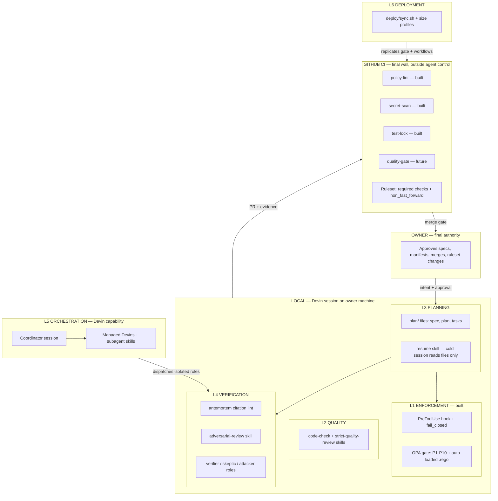
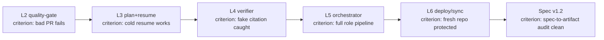
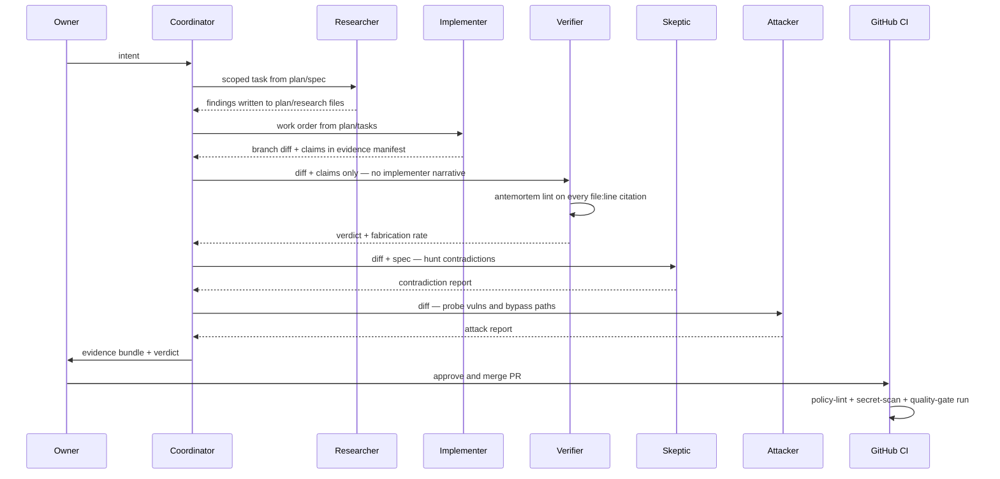

# ROADMAP — Complete Governance System

> Purpose: the full map before building. Every layer, phase, tool, and what "done" means.
> Status: design only. Nothing in this document is implemented beyond L1.

## 1. Big Picture

Capability placement: hooks+OPA live in L1 (local runtime). Skills live in L2/L3/L4 (advisory + process). Managed Devins + subagents live in L5. Playbooks/knowledge are org-level support for L5/L6. CI+rulesets are the only layer outside the agent's environment — the final wall (ADR-004).

**L0 self-review (designed, not built — 2026-11-09):** a cross-cutting watchtower that audits the agent's own responses against the philosophy before send — every response in governance-dev, advisory everywhere, seeded-violation tested here only. Design: docs/SELF_REVIEW_DESIGN.md. Status: GAP-SELF-01/02 in GAPS.md.

## 2. Phase Map

| Phase | Builds | Tools | Completion criterion | Depends on | Risk if skipped |
|---|---|---|---|---|---|
| L2 | quality-gate CI + review skills | ESLint/Semgrep or ai-coding-rules-scaffold; code-check; strict-quality-review | Seeded spaghetti/hardcoded PR fails the new check | L1 done | Spaghetti merges legally under safety-only gates |
| L3 | plan/ convention + resume skill | spec-kit OR vaultspec OR own convention | Cold session completes task reading only plan/ files | L2 | L4 verification has no fixed spec anchor |
| L4 | verifier + skeptic + attacker on PR | antemortem lint/gate; adversarial-review; agent-eval-mcp (opt) | Seeded fabricated file:line claim flagged on test PR | L3 | Clever Hans unguarded — the core gap stays |
| L5 | coordinator + isolated workers | Managed Devins / subagent profiles | implementer→verifier→skeptic pipeline on one real feature, artifacts logged | L4 | Implementer self-approval hole |
| L6 | one-command sync + profiles | deploy/sync.sh; ruleset API; profiles YAML | Fresh repo protected end-to-end; test PR blocked | L5 | Everything stays a governance-dev demo |
| Spec | GOVERNANCE_SPEC v1.2 | docs audit | Every spec claim maps to an artifact | all | Spec rots into fiction |

## 3. Tool Map

| Tool | Layer | Role | Added when | Install | Windows/WSL2 | Devin-fit |
|---|---|---|---|---|---|---|
| OPA | L1 | runtime PDP | built | static binary | WSL2 yes (in use) | n/a (host-level) |
| gitleaks | L1/CI | secret scan | built | binary in CI | CI Linux | n/a |
| ESLint/Semgrep | L2 | quality gate | L2 | npm/pip | WSL2 yes | CI step |
| ai-coding-rules-scaffold | L2 | pre-commit+CI mirror | L2 alt | install.sh | WSL2/Git-Bash (v0.10 notes Win fixes) | agent-agnostic |
| code-check skill | L2 | advisory audit | L2 | skills.sh→.devin/skills/ | yes | yes (SKILL.md) |
| strict-quality-review | L2 | adversarial structure | L2 | same | yes | yes |
| spec-kit | L3 | SDD pipeline | L3 | uvx specify-cli | WSL2 yes; agent skills port needed — partially unverified | medium |
| vaultspec-core | L3 | decision vault | L3 alt | pip ≥3.13 | WSL2 yes | medium — Claude/Codex-native rules |
| antemortem | L4 | citation lint + CI gate | L4 | pip install antemortem | WSL2 yes; Py≥3.11 | high — CLI+MCP |
| agent-eval-mcp | L4 | AST edit eval | L4 opt | pip | WSL2 yes | MCP-compatible; low maturity |
| adversarial-review | L4 | skeptic skill | L4 | skills.sh→.devin/skills/ | yes | yes |
| Managed Devins | L5 | isolated workers | L5 | built-in (cloud) | n/a | native; ACU cost |
| subagent profiles | L5 | cheap isolation | L5 | .devin/agents defs | yes | native |
| deploy/sync.sh | L6 | replication | L6 | ours | WSL2 bash | n/a |
| SonarQube/SonarCloud | L2 opt | deep quality | L6/ERP | cloud | n/a | already runs on ci-test PRs |

## 4. Role Architecture

Evidence flows as files (plan/, evidence/Pn/, PR diff) — never as conversation between workers. Implementer and verifiers never share context: verifier reads artifacts, not the implementer's story — that is the structural Clever Hans defense.

## 5. Quality Model — what "good" means

| Check | Concrete rule | Deterministic? | Tool | Status |
|---|---|---|---|---|
| File size | ≤400 lines src, ≤100 .rego | yes — fails build | wc/ast + brace heuristic in quality-gate (A1) | **implemented L2a** |
| Function size | ≤50 lines, ≤4 params | yes | python ast (.py) + brace-span heuristic (JS/TS/Go/…) in quality-gate (A1) | **implemented L2a** (≤4 params deferred to L2d) |
| Complexity | cyclomatic ≤10, nest depth ≤3 | yes | ESLint complexity, max-depth / ruff | planned (L2d per-language) |
| Duplication | >5% copied tokens fails | yes | jscpd --min-tokens 50 --threshold 5 (A7) | **implemented L2a** |
| Secrets | sk-/AWS/key patterns + custom | yes | gitleaks + .gitleaks.toml + P3 | implemented (P7) |
| Debug leftovers | print/console.log/debugger/pdb | yes | diff-scoped grep patterns in quality-gate (A8) | **implemented L2a** |
| Silenced errors | bare except/empty catch | yes | diff-scoped grep patterns in quality-gate (A8) | **implemented L2a** |
| Hardcoded values | credentials/paths/URLs/magic numbers | yes | Lyncus rule engine in quality-gate (A3) | **implemented L2a** |
| API contract | breaking changes vs base spec | yes | api-contract-guard --mode openapi (A4) | **implemented L2a** |
| Mutation score | ≥60% on changed files | yes | mutmut only_mutate=changed (A5) | **implemented L2a** |
| Diff coverage | ≥80% on changed lines | yes | pytest-cov + diff-cover (A6) | **implemented L2a** |
| God class / spaghetti | SRP, cohesion | judgment | review skills advisory | stays advisory (L2c) |
| SOLID/OOP design | DIP, OCP, naming | judgment | review skills advisory | stays advisory (L2c) |
| Centralized vars | config module exists; magic values | hybrid | lint known patterns + advisory | partially via A3 |
| Clever Hans | claims cite real file:line | yes for citations | antemortem lint — logic itself stays judgment | planned (L4) |

Layer A shipped as `.github/workflows/quality-gate.yml` (single required check `quality-gate`), verified 2026-11-09 on seeded bad PR #1 (A1/A3/A5/A6/A8 fail, merge BLOCKED) and clean PR #2 (all pass, 27s runtime, merge ALLOWED). See docs/L2_IMPLEMENTATION.md.

**L3 planning shipped 2026-11-09:** plan/ convention (spec→approval→tasks→approval→code) enforced by `policies/p12_require_plan.rego` (verified: src/ write blocked live; approved env → allowed via opa eval). Skills: spec-driven-development + planning-and-task-breakdown (adopted) + plan-resume (custom; session-handoff adopted for generic handoffs). gate.sh env wiring is P4-blocked — owner patch in docs/PLANNING.md; P12 fails closed until applied.

**All L2 layers shipped 2026-11-09:** Layer B = `quality-gate-deep` (risky PRs: dep-arch/import-linter+depcruise, complexity, polyscan coupling, pyscn CFG dead code, module-scope mutmut, strict API contract) — proven on risky PR #3 (B1/B4/B5 fail, merge BLOCKED). Layer C = advisory skills in `.devin/skills/` (4 adopted from skills.sh + 1 custom logic-flow-review — never block). Layer D = `quality-gate-perlang` (py/js/go adapters). SonarQube running localhost:9000 LOCAL-ONLY (owner password; CI can't reach).

Honest split: ~8 deterministic build-failers, ~3 judgment-only. Deterministic gates go in CI; judgment stays skill-advisory — never pretend a rubric is a gate.

## 6. Security Model

| Threat | Guard | Enforcement or detection |
|---|---|---|
| Secret in tool payload | P3 (proven on me) | enforcement — blocks write/exec |
| Secret in diff | P7 gitleaks + custom rule | enforcement — blocks merge |
| Known sensitive files | P8 | enforcement — blocks write |
| Governance files | P4 + CODEOWNERS + policy-lint | enforcement — evidence gate + owner review |
| `devin -p --config` bypass | none beyond auth wall | detection only — ERR-009 gap |
| Direct local exec | hook seam | detection only — documented fail-open |
| Force push | P9 + ruleset non_fast_forward | enforcement both layers |
| Data exfil via webfetch/MCP | P10 heuristics | partial — obfuscation gap documented |
| Supply chain deps | none | **uncovered** — candidate: npm/pip-audit in quality-gate |
| Obfuscated secrets | none | uncovered — entropy rules could extend gitleaks |

## 7. Scaling Model

| Profile | Layers active | Ruleset | Verifier | Example |
|---|---|---|---|---|
| small | L1 + gitleaks | optional; direct push OK | advisory skills only | scripts, utilities |
| medium | L1+L2+L3+L4-PR | required checks, PR flow | verifier on every PR | mail-assistant, apps |
| erp | all + L5 orchestration | strict: empty bypass, CODEOWNERS, PR required | full role pipeline | multi-team systems |

`deploy/profiles/{small,medium,erp}.yaml` — each lists enabled checks, ruleset template, skills to install. sync.sh applies the profile: copy policies+workflows+config, create ruleset via gh api, open bootstrap PR.

## 8. NOT in this roadmap (honest)

- Multi-team coordination / CODEOWNERS teams — sole owner today
- SOC2/ISO/compliance-grade audit — evidence chain is engineering-grade, not audit-grade
- ACU cost modeling for L5 — unmeasured; needs one pipeline run to price
- Model selection (SWE variants) — out of scope
- Non-Devin agents (Cursor/Copilot) — hook contract is Devin-specific
- Non-GitHub hosts — ruleset model is GitHub; GitLab/Bb would need port
- Base64/obfuscated secret detection — documented P10 gap, deferred

## 9. Open Questions (owner decisions blocking phases)

1. First target project + stack after governance-dev — sets L2 toolchain and deploy profile.
2. L3 backbone: spec-kit (official, heavier) vs vaultspec (fits evidence/+ADR convention) vs own plan/ convention (lightest, already proven pattern).
   **DECIDED (owner):** own plan/ convention — plan/spec.md + plan/tasks.md.
3. Verifier input contract: what exactly enters the evidence bundle — diff+spec+manifest? Who signs the verdict artifact?
   **Default:** bundle = PR diff + plan/spec.md + implementer's evidence manifest; verifier writes `evidence/P<n>/verdict.json` (signed by role name + antemortem fabrication rate). Rationale: three artifacts are already P4-protected paths; verdict-as-file makes the check auditable by CI.
4. Skeptic vs attacker: is skeptic = logic adversary and attacker = security adversary, same session or different? Undefined today.
   **DECIDED (owner):** single adversarial role now; split into separate sessions at ERP scale.
5. Verifier trigger: every PR (ACU cost) or risk-threshold (diff size, file paths)?
   **Default:** risk-threshold — verifier runs when diff >200 lines OR touches protected paths (policies/, workflows/, src/); tiny PRs get antemortem lint only (deterministic, free). Rationale: LLM roles cost ACU; deterministic lint catches fabrication cheaply on small diffs.
6. Merge authority: can coordinator merge green low-risk PRs, or is owner approval always required? Assume always until told.
   **Default:** owner approval always required — no auto-merge path in dev or production. Rationale: the entire system exists because self-approval fails; a coordinator that can merge is the implementer loophole moved up one level.
7. Quality limits: file ≤400 / function ≤50 correct for owner's style, or stricter?
   **Default:** file ≤400 src / ≤100 .rego (proven convention), function ≤50 lines, ≤4 params, cyclomatic ≤10. Rationale: .rego 100-line cap already enforced by policy-lint; 400/50 matches agent context-window ergonomics (the real reason for the cap).
8. Evidence format: self-asserted manifest.json vs signed attestations.
   **DECIDED (owner):** adopt in-toto attestation shape (Statement+Predicate+Subject) at L4 build; verdict artifacts follow the same shape.
9. Test adequacy: tests' integrity is protected (P2/test-lock) but their competence is unchecked.
   **DECIDED (owner):** adopt mutation testing at L4 build — mutation score gate on touched tests, stack-appropriate tool (mutmut/Stryker).
10. Deployment tool: hand-rolled sync.sh vs template engine.
    **DECIDED (owner):** copier — `copier copy` installs, `copier update` propagates governance upgrades (REASSESSMENT §3).
