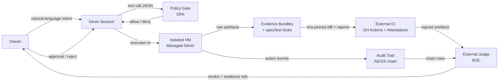
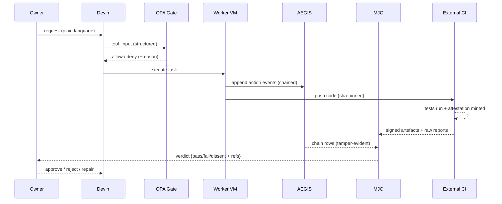

# GOVERNANCE_BUILD_PLAN.md

**Version**: 1.0
**Status**: Draft — pending owner approval before any build
**Reference**: GOVERNANCE_SPEC.md (v1.0) + diagnosed problems S1–S5

---

## 1. Scope

### WILL build
- A policy gate (OPA as PDP) intercepting tool calls before execution — decision on structured input, not text patterns.
- A tamper-evident audit trail (AEGIS) recording every governed action as a hash-chained, signed sequence.
- An external judge (MJC) issuing structured verdicts on raw artefacts.
- A phase/evidence model: evidence bundles, spec/test locks, owner approval checkpoints (M1/M2/M3/M4/M8).
- External provenance: CI-produced, cosign-signed/attested artefacts that agents cannot forge.

### WILL NOT build
- A lexical/textual command wall (proven unsealable — replaced by structured policy + isolation).
- In-process OS containment of Devin's tools (structurally impossible under one principal — S1/S2; handled by Managed Devins).
- A custom policy engine, signer, or judge model — researched tools only.
- Automatic repair/fix agents for security findings (attacker documents, implementer fixes).
- Per-project file trees until P0 of each governed project starts (no speculative scaffolding).

### Scope boundaries (proportional governance)
- **Small (≤500 lines)**: P0, P3, P5 + M1/M2/M4/M8 only.
- **Medium**: P0–P5 + M1–M8 (M6 only for web-facing).
- **Large**: full spec — all phases, all mechanisms, all roles.

---

## 2. Architecture

- **Owner**: sole authority over approvals (M8); approves spec, phase transitions, releases.
- **Devin**: orchestrating session (R1) spawning role-scoped Managed Devins.
- **OPA**: PDP evaluating structured tool_input; deny-by-default on the four initial policies.
- **AEGIS**: append-only hash chain + Ed25519 certs; records what actually happened.
- **MJC**: deterministic structured judge reading raw artefacts, not agent summaries.
- **External CI**: the only artefact producer outside the agent's write reach — the trust anchor.

---

## 3. Tool Selection

| Component | Tool | Why chosen | Alternative | Evidence | Status |
|---|---|---|---|---|---|
| Policy Gate | **OPA** | Evaluates structured JSON fields (workdir, command, path) — the exact bypass class the lexical wall lost to | Cedar | Installed; PEP via Devin PreToolUse hooks (documented) | Installed |
| Audit Trail | **AEGIS (crabsatellite/aegis-protocol)** | Zero-dependency SHA-256 chain + Ed25519 certs; third-party verifiable | MAREF (research-stage) | 202-test reference impl. (GitHub) | Needs install |
| External Judge | **MJC** | Deterministic judge — not another LLM sharing model-class failure modes | LLM-as-judge via MCP | Spec appendix B (needs setup) | Needs install |
| Identity | **SPIFFE/SPIRE** | Short-lived crypto identity per workload — real second principal | None viable locally | CSA AIGF framework reference | Deferred (K8s-scale) |
| Signing | **cosign** | Keyless Sigstore: OIDC-bound certs + Rekor transparency | GPG (key mgmt burden) | Installed; GH Actions native | Installed |
| External Evidence | **GitHub Artifact Attestations** | Provenance bound to repo+workflow sha — outside agent write reach | SLSA generators | `gh attestation verify` built-in | gh installed |

Limits stated: OPA decides, does not enforce itself (hook must fail-closed); AEGIS records, does not capture (adapter needed); MJC unproven until installed; SPIRE heavy for a single box; cosign/attestations require the workflow file itself be protected (CODEOWNERS + reusable workflow).

---

## 4. Data Flow

---

## 5. Build Order

| # | Phase | Builds | Tools | Completion criterion | Depends on |
|---|---|---|---|---|---|
| B1 | Policy gate | OPA policies (deny_wsl_root, deny_test_edit, deny_secrets, require_evidence) + PreToolUse hook wiring | OPA, hooks.v1.json | OPA blocks `wsl -u` attempts made through governed tools (exec, bash -c). Test: 3 known patterns blocked; benign call allowed. Residual bypasses documented in R5 — prevention not claimed | — |
| B2 | Audit trail | AEGIS adapter: hook events → chain rows; verify + tamper test | AEGIS | Forged/edited row breaks verification; 100% of governed calls produce chain rows | B1 |
| B3 | Evidence + locks | evidence/P<n>/ + manifest.json + spec.lock/tests.lock verify step | sha256, jq | Lock mismatch halts phase; missing manifest fails gate | B1 |
| B4 | External judge | MJC wired on Stop event; reads fixed artefact paths, returns structured verdict | MJC, Stop hook | Stop cannot complete without verdict; verdict cites artefact lines | B2, B3 |
| B5 | External CI | Protected workflow (reusable, CODEOWNERS) running tests + minting attestations | gh, cosign, GH Actions | Forged test-report (agent-written) fails attestation check; real CI report verifies | B3 |
| B6 | Integration | End-to-end dry run on owner's real project (TBD by owner). Note-app pilot archived, not the integration target | all above | Full P0→P5 run produces verdict + chain + attested evidence | B1–B5 |

---

## 6. Risks

| # | Risk | Likelihood | Impact | Mitigation |
|---|---|---|---|---|
| R1 | Hook fires late/fails open → gate never evaluated | medium | high — silent bypass | fail_closed:true + Stop hook asserts gate ran; heartbeat proves firing |
| R2 | Artefacts forged before reaching judge (S5) | high | high — judge seals a lie | CI is the only artefact source for pass/fail claims; MJC reads CI output not agent files |
| R3 | OPA policy bug = false allow or DoS | medium | medium | policies versioned + tested against recorded payloads; default-deny |
| R4 | MJC unavailable/misbehaves → sessions hang | medium | medium | timeout + owner release path (documented, unverified-class, never silent) |
| R5 | `wsl -u` / ambient escapes bypass the gate entirely | high | high | policy covers wsl family + documented residual: local execution is detection-tier, prevention lives in Managed Devins + CI |

---

## 7. Success Criteria

1. OPA blocks 100% of `wsl -u` attempts made through governed tools (exec, bash -c). Residual ambient escapes documented in R5 as detection-only — not claimed as prevented.
2. AEGIS records 100% of governed tool calls; any edited row fails verification.
3. MJC returns a structured verdict (pass/fail/dissent + evidence refs) in < 30 seconds, mandatory before phase close.
4. Forged artefact detection: agent-written `test-report.log` claiming PASS is rejected 100% when CI attestation disagrees.
5. Spec/test lock: any post-freeze modification halts the next phase automatically.
6. Owner approval: 0 phase transitions or releases recorded without an `approvals/` entry.
7. Every mechanism failure surfaces as a visible log/marker — zero silent failures.

---

**End of plan.**
